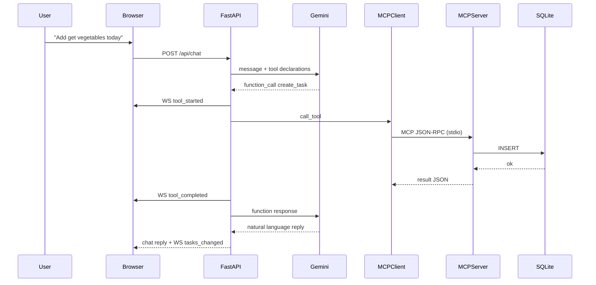
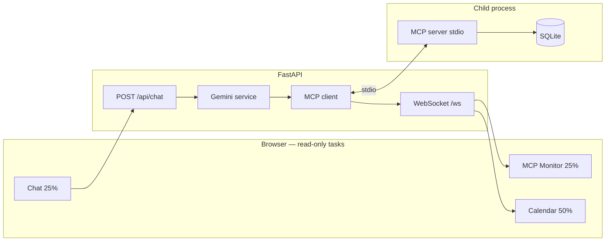

# MCP Playground — AI-Powered Daily Todo Manager

An educational demo that shows the **full Model Context Protocol (MCP) loop** in a real UI:

**User message → Gemini → tool selection → MCP `call_tool` → SQLite → live WebSocket updates**

The center panel is the main teaching surface: every tool name, argument JSON, status, duration, and result is visible in real time.

---

## What is MCP?

**MCP (Model Context Protocol)** is a standard way for AI applications to discover and call **tools** exposed by external programs—without baking database logic into the model.

| Piece | Role |
|--------|------|
| **AI model (Gemini)** | Decides *whether* to call a tool and with *what arguments* (function calling). |
| **MCP client** (in FastAPI) | Speaks MCP over **stdio** to a child process: `list_tools`, `call_tool`. |
| **MCP server** (`app/mcp_server/server.py`) | Registers the six task tools and runs them against SQLite. |
| **MCP tool** | One capability (e.g. `create_task`) with a JSON schema for inputs. |

MCP does **not** replace REST or SQL. Here, Gemini never touches SQLite directly—it only sees Gemini-style function declarations that we **adapt** from MCP tool schemas.

---

## Architecture





---

## Tool discovery and invocation

1. **Startup** — FastAPI spawns `python -m app.mcp_server.server` and calls `initialize` + `tools/list`.
2. **Adapter** — Each MCP `inputSchema` is mapped to a Gemini `FunctionDeclaration`.
3. **Chat loop** — Gemini returns `function_call` → MCP `call_tool` → result back to Gemini until plain text.
4. **Events** — Each call emits `tool_started` / `tool_completed` / `tool_failed` on `/ws`.

### Six tools

- `create_task`, `list_tasks`, `update_task`, `delete_task`, `complete_task`, `reopen_task`

---

## Run locally

### Prerequisites

- Python 3.11+
- A [Gemini API key](https://aistudio.google.com/apikey)

### Setup

```bash
cp .env.example .env
# Edit .env and set GEMINI_API_KEY=...
pip install -r requirements.txt
```

### Start

```bash
# From project root (so `app` is importable)
uvicorn app.main:app --reload --host 0.0.0.0 --port 8000
```

Open **http://localhost:8000**

### Docker Compose

```bash
cp .env.example .env   # set GEMINI_API_KEY
docker compose up --build
```

SQLite lives in `./data` (mounted volume).

---

## Example interactions

Try these in the chat (task list is **read-only** in the UI—all changes go through MCP):

- "Add get vegetables task today."
- "Move the grocery task to tomorrow."
- "Show me all my tasks for this week."
- "Mark the grocery task as completed."
- "Delete the meeting task scheduled for Friday."

Watch the **Live tool execution** feed for each MCP call.

---

## Configuration

| Variable | Default | Description |
|----------|---------|-------------|
| `GEMINI_API_KEY` | — | Required. Never sent to the browser. |
| `GEMINI_MODEL` | `gemini-2.5-flash` | Model with tool calling |
| `APP_TIMEZONE` | `Asia/Kolkata` | Used in system prompt and calendar |
| `DATABASE_PATH` | `data/tasks.db` | SQLite file |

---

## Project layout

```
app/
  main.py              # FastAPI app, static files, lifespan MCP connect
  api/                 # chat, tasks (read), websocket
  services/            # gemini_service, mcp_client, event_bus
  mcp_server/          # stdio MCP server + tool handlers
  database/            # SQLite repository
  static/              # Premium dark UI (Supabase-inspired tokens)
```

---

## Verify the demo

- [ ] `/health` shows `mcp_connected: true` and 6 tools
- [ ] MCP monitor lists all tools and increments execution counts
- [ ] Chat triggers visible `tool_*` WebSocket events
- [ ] Calendar updates without manual edits (read-only task cards)
- [ ] Sample seed tasks appear for the current week

---

## License

MIT — for learning and experimentation.